# Diamond Price Prediction

> A regression machine learning project that estimates diamond prices using physical measurements and quality grades, supported by exploratory analysis and an interactive Streamlit prototype.

**Status:** Model artifacts and application code are present. The deployment configuration and reported model performance require independent verification.  
**Tools:** Python, pandas, NumPy, scikit-learn, XGBoost, LightGBM, CatBoost, Plotly and Streamlit.


## Executive Summary

Diamond prices vary substantially with carat weight, cut, colour, clarity and physical dimensions. This project explores these relationships, engineers predictive features and compares regression techniques for estimating diamond prices. The repository contains the dataset, exploratory modelling notebook, serialized model artifacts, a Streamlit app and screenshots.

The application exposes diamond attributes as user inputs, constructs engineered features, calls a saved prediction model and attempts to reverse a target power transformation to display an estimated price. The present documentation distinguishes implementation from demonstrated performance, because the reported accuracy and deployment need to be reproduced using the included code and files.

## Business Problem and Objectives

A diamond valuation analyst or retailer may need an initial data based estimate that accounts for both size and quality. This project investigates the relationship between diamond attributes and observed prices and prototypes an interactive estimate. It does not establish an independently validated market appraisal or a live pricing service.

Objectives include analysing price drivers, managing categorical attributes and correlated dimensions, comparing regression models, measuring prediction errors and presenting the result through a user interface.

## Data Sources

The repository includes `Data/data.csv` and an exploratory notebook at `diamond-price-prediction/Diamond_price_prediction_note.ipynb`. The analysis is based on the Diamonds dataset commonly distributed through Kaggle. The original project analysis describes approximately 53,940 observations. Verify dataset provenance, attribution and licensing before external redistribution.

| Field family | Variables | Role |
| --- | --- | --- |
| Quality | Cut, colour, clarity | Categorical predictors |
| Size and dimensions | Carat, depth, table, x, y, z | Numeric predictors |
| Target | Price | Continuous price prediction |

## Workflow and Architecture

```mermaid
flowchart LR
    A[Diamond dataset] --> B[Explore and clean data]
    B --> C[Encode quality grades]
    C --> D[Engineer carat and dimension features]
    D --> E[Train and compare regression models]
    E --> F[Evaluate on held out data]
    F --> G[Save model and target transformer]
    G --> H[Streamlit diamond configurator]
    H --> I[Estimate diamond price]
```



The notebook documents the analysis and experimentation. The app implements manual encodings for cut, colour and clarity, a calculated principal component for dimensions, a squared carat term, and carat by clarity and cut by colour interactions. It then scales input features using fixed constants before loading a serialized model and inverse transforming its prediction.

**Important:** Manually reproduced transformations must match the fitted training transformations exactly. The current code should be tested for consistency with the saved model artifacts before relying on generated prices.

## Methodology

The research workflow considers several regression approaches, including linear regression, decision trees, random forests and gradient boosting models. The repository's model development notebook should remain the source for final hyperparameters and experiment results. The Streamlit application imports a serialized model from a pickle file rather than refitting the model when launched.

Core feature engineering demonstrated by the app:

1. Ordinal mapping of cut, colour and clarity grades.
2. Principal component approximation from standardised physical dimensions.
3. Squared carat weight.
4. Interactions between carat and clarity and between cut and colour.
5. Manually applied numerical scaling.
6. Inverse transformation of model output to the displayed price scale.

## Model Evaluation

The project's earlier analysis records the following model comparisons. These are **historical project figures**, not results independently reproduced in this documentation revision.

| Model | Reported R² | Reported MSE |
| --- | ---: | ---: |
| Linear regression | 0.9052 | 1,500,220 |
| Tuned decision tree | 0.9724 | 437,411 |
| Tuned random forest | 0.9798 | 318,979 |

Before publishing a definitive performance claim, rerun evaluation from a clean environment, identify the exact train/validation/test split, verify that preprocessing was fitted only on training data, and calculate MAE, RMSE and R² on the original price scale. The app's existing promotional phrase “98.2% accuracy” is not an appropriate unqualified metric for this regression problem.

## Application Screenshots

### Interactive configuration


### Price prediction view


### Historical analysis


These images are existing repository screenshots. They are illustrative of the user interface and should not substitute for independent model evaluation.

## Repository Structure

```text
Data/
    data.csv
Model files/
    diamond_price_model.pkl
    xgboost_diamond_model.pkl
    power_transformer.pkl
    final_dataset.pkl
diamond-price-prediction/
    Diamond_price_prediction_note.ipynb
    app.py
    requirements.txt
screenshots/
    app-interface.png
    prediction-results.png
    historical-chart.png
docs/
    legacy-readme.md
```

## Installation and Reproducibility

Clone this repository and create a Python environment with the application's dependencies:

```bash
git clone https://github.com/TeslimAdeyanju/Diamond-Price-Prediction.git
cd Diamond-Price-Prediction
python3 -m venv .venv
source .venv/bin/activate
python -m pip install -r diamond-price-prediction/requirements.txt
streamlit run diamond-price-prediction/app.py
```

**Known file path issue:** `app.py` currently tries to load `diamond_price_model.pkl` and `power_transformer.pkl` beside the app, while the committed artifacts live in `Model files/` at the repository root. Its sample dataset loader also expects `final_dataset.pkl` relative to the current directory and substitutes synthetic data if it cannot find it. These paths must be fixed and the model loading tested before considering the above commands a verified end to end run. The generated sample data is not evidence of real observed market patterns.

## Limitations and Next Steps

1. Repair and test all model and dataset paths across working directories.
2. Persist the complete fitted preprocessing pipeline rather than reconstructing PCA and scaling with hardcoded values.
3. Reproduce model comparisons and display correctly named regression metrics.
4. Distinguish genuine model explanations from illustrative heuristic feature contribution charts.
5. Verify predictions across realistic inputs and reject impossible dimensions.
6. Add automated app and inference tests, deployment instructions and dependency compatibility checks.
7. Document data licence, evaluation period, sample coverage and price currency explicitly.

## Responsible Use

Predictions are exploratory estimates based on the project's historical dataset, not certified diamond valuations, investment recommendations or live retail quotations.

## Author

**Teslim Adeyanju**  
[GitHub](https://github.com/TeslimAdeyanju) | [Portfolio](https://adeyanjuteslim.co.uk) | [LinkedIn](https://www.linkedin.com/in/adeyanjuteslimuthman)

[Original README archive](docs/legacy-readme.md)
