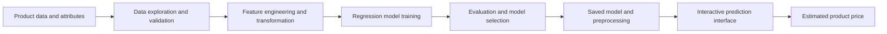

# Product Price Prediction and Analytics Using Machine Learning

> An applied machine learning project that investigates how product features influence prices, engineers predictive variables and develops regression models to estimate product value.

**Project status:** First product case study implemented as a research notebook and Streamlit prototype. Model performance and application reproducibility require further verification.  
**Core technologies:** Python, pandas, NumPy, scikit-learn, XGBoost, LightGBM, CatBoost, Plotly and Streamlit.

## Executive Summary

Product pricing is influenced by a combination of measurable characteristics, quality attributes and market conditions. Understanding the relationship between those features and observed prices is valuable for pricing analysis, product comparison, valuation research and decision support.

This project demonstrates a feature based approach to **product price analytics and prediction**. It combines exploratory data analysis, data preparation, feature engineering, regression modelling, model evaluation and an interactive prediction interface. The objective is to develop a repeatable analytical workflow that can be adapted to additional product categories once suitable data and trained models are available.

**Current implementation:** Diamonds are the first product case study. All existing datasets, models, results and application screenshots relate to diamonds. The system is not yet a general purpose price predictor for unrelated products.

## Business Problem and Objectives

Products with different technical specifications or quality attributes often have substantially different prices. A pricing analyst needs to answer three questions: which attributes are associated with price, how reliably can they predict price, and how can those predictions be presented to support business decisions?

The project objectives are to:

1. Explore how product attributes relate to observed prices.
2. Identify relevant features and assess correlations and interactions.
3. Transform categorical and numerical features for predictive modelling.
4. Train and compare regression algorithms against consistent evaluation criteria.
5. Translate model predictions into an accessible interactive application.
6. Establish a reusable methodology for future product pricing case studies.

The goal is to demonstrate analytical and modelling competence, not to claim a commercially validated pricing engine.

## Project Architecture



The workflow separates descriptive analysis from predictive modelling. Models need product specific data, target definitions and evaluation before they can be extended to new categories.

## Case Study 1: Feature Based Diamond Pricing

The initial case study uses diamonds because the dataset includes both categorical quality attributes and continuous physical measurements. This makes it suitable for studying nonlinear relationships and feature interactions in price estimation.


### Dataset and features

The dataset is stored in `Data/data.csv`. The research notebook is `diamond-price-prediction/Diamond_price_prediction_note.ipynb`. Earlier project analysis describes about 53,940 observations. Dataset provenance and licensing require confirmation before redistribution.

| Variable group | Features | Analytical purpose |
| --- | --- | --- |
| Product quality | Cut, colour, clarity | Assess qualitative attributes |
| Product dimensions | Carat, depth, table, length, width, height | Measure physical properties |
| Engineered predictors | Squared carat, dimension PCA, interaction terms | Capture nonlinear and joint effects |
| Target | Price | Predict a continuous monetary value |

### Data analytics and feature engineering

The case study explores distributions, associations and differences in prices across product features. Its application code demonstrates ordinal encoding for product grades, an approximate principal component from dimensions, a squared carat variable, interaction terms and numerical scaling.

These transformations illustrate how original attributes can become model inputs. The application currently recreates some transformations from manually entered parameters. For reliable inference, the complete fitted preprocessing pipeline should be saved and reused rather than recreated independently.

### Regression modelling

The research workflow explores linear regression, decision trees, random forests and boosting methods. This provides a comparison of simpler statistical approaches with more flexible nonlinear estimators.

### Historical model evaluation

The following figures come from earlier project analysis. They have **not been independently reproduced** during the README revision.

| Model | Reported R² | Reported MSE |
| --- | ---: | ---: |
| Linear regression | 0.9052 | 1,500,220 |
| Tuned decision tree | 0.9724 | 437,411 |
| Tuned random forest | 0.9798 | 318,979 |

These are regression results. They should not be described as classification accuracy. Before citing them as final results, rerun training with documented data splits, check for data leakage, ensure preprocessing is fitted only on training data and report MAE, RMSE and R² on the original price scale.

## Application and Outputs

The Streamlit prototype lets users enter a product's diamond quality grades and measurements, constructs the required model features, loads a saved model, and attempts to transform its output into an estimated price.

| Interface | Preview |
| --- | --- |
| Product feature configuration |  |
| Predicted price and supporting views |  |
| Historical data analysis |  |

These are actual screenshots from the repository. They demonstrate the interface, not independent evidence that the estimates are accurate or the deployment works in a fresh environment.

## Technology Stack

| Technology | Role |
| --- | --- |
| Python, pandas and NumPy | Data handling, transformation and analysis |
| scikit-learn | Feature processing, regression and evaluation |
| XGBoost, LightGBM and CatBoost | Additional modelling frameworks explored |
| Plotly, Matplotlib and Seaborn | Data visualisation |
| Streamlit | Interactive prediction prototype |
| Pickle | Saved model and transformation artifacts |

## Repository Structure

```text
Data/
    data.csv
Model files/
    diamond_price_model.pkl
    xgboost_diamond_model.pkl
    power_transformer.pkl
    final_dataset.pkl
diamond-price-prediction/
    Diamond_price_prediction_note.ipynb
    app.py
    requirements.txt
screenshots/
    app-interface.png
    prediction-results.png
    historical-chart.png
docs/
    legacy-readme.md
```

The existing code and artifact names continue to use `diamond` because this is the first implemented case study. The broader project branding does not require changing those working file identities.

## Installation and Reproducibility

```bash
git clone https://github.com/TeslimAdeyanju/Product-Price-Prediction-and-Analytics.git
cd Product-Price-Prediction-and-Analytics
python3 -m venv .venv
source .venv/bin/activate
python -m pip install -r diamond-price-prediction/requirements.txt
streamlit run diamond-price-prediction/app.py
```

**Known setup limitation:** The Streamlit application attempts to load saved model files beside `app.py`, whereas the committed files reside in the root `Model files/` directory. The sample dataset loader also uses a working directory relative path and may generate synthetic demonstration data when the saved dataset cannot be loaded. The paths and full inference pipeline need correction and testing before these commands can be described as a verified end to end deployment.

## Current Limitations

1. The trained models apply only to the diamond case study.
2. Reported evaluation scores require reproducible confirmation.
3. Model and sample data paths need correction.
4. Preprocessing should be saved and reused as a fitted pipeline.
5. The app includes simplified illustrative feature impact calculations rather than validated model explanations.
6. Dataset attribution, monetary units, input validity checks and compatibility testing need additional documentation.

## Future Development

The longer term direction is a **product price analytics framework**, with each additional case study developed and validated independently.

Potential extensions include new datasets for electronics, vehicles or property; product specific preprocessing pipelines; baseline comparisons; interpretability methods; robust testing; and consistent visual reports. These are **future possibilities**, not currently supported model capabilities.

## Responsible Use

Outputs are exploratory estimates based on historical case study data. They are not certified valuations, guaranteed retail prices or a substitute for professional commercial assessment.

## Author and References

**Teslim Adeyanju**  
[GitHub](https://github.com/TeslimAdeyanju) | [Portfolio](https://adeyanjuteslim.co.uk) | [LinkedIn](https://www.linkedin.com/in/adeyanjuteslimuthman)

[Original README archive](docs/legacy-readme.md)
